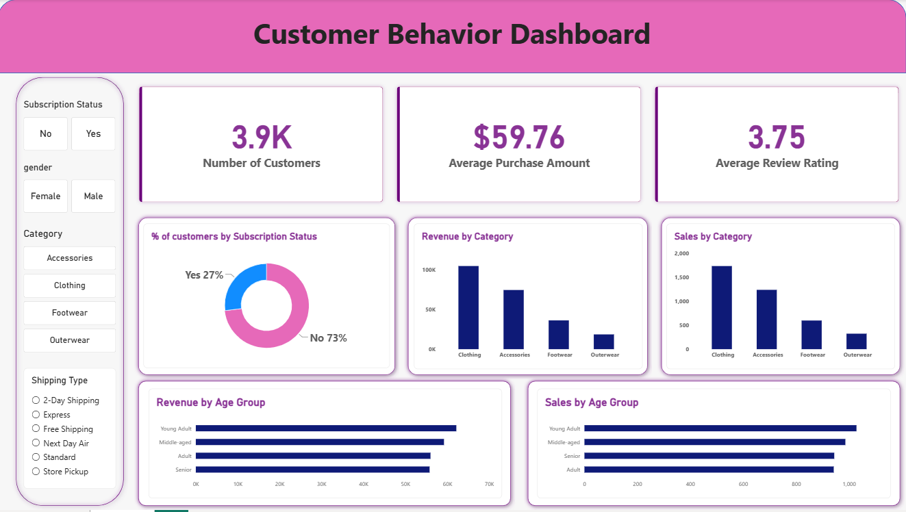

# customer_behavior_analysis
Data Analytics Project showcasing customer behavior analysis using Python, SQL & Power BI.

1. Overview

This project demonstrates an end-to-end data analytics workflow, transforming raw data into meaningful insights using Python, SQL, and Power BI.

The project covers data loading, exploratory data analysis (EDA), data cleaning, SQL-based analysis, interactive dashboard development, report preparation, and presentation creation using Gamma.

Objective: To analyze data, identify patterns and trends, answer business questions, and present actionable insights through clear visualizations and reports.

2. Dataset

The dataset is used to explore trends, identify relationships, and derive meaningful insights.

Format: CSV / Excel

Description: [Briefly describe the dataset and its purpose]

Key Columns: [List important columns]

Target: Identify trends, patterns, and insights that support data-driven decision-making.

Note: Replace the placeholders with details about your actual dataset.

3. Tools & Technologies

Python: Data processing, analysis, and automation.

Pandas & NumPy: Data manipulation and numerical operations.

Matplotlib & Seaborn: Exploratory data analysis and visualization.

Jupyter Notebook: Interactive Python analysis.

SQL: Data querying and business analysis.

PostgreSQL / MySQL / SQL Server: Relational database management systems for executing SQL queries.

Power BI: Interactive dashboards and data visualization.

Gamma: Presentation creation and storytelling.

Git & GitHub: Version control and project documentation.

4. Project Workflow

Step 1: Load the Dataset

Import the dataset into Python using Pandas.

Inspect the dataset structure, dimensions, and data types.

Review sample records to understand the data.

Step 2: Exploratory Data Analysis (EDA)

Analyze descriptive statistics and data distributions.

Identify patterns, trends, and relationships.

Examine missing values, duplicates, and outliers.

Create visualizations to understand the dataset.

Step 3: Data Cleaning & Preprocessing

Handle missing and duplicate records.

Correct data types and inconsistent values.

Standardize column names and formats.

Validate the cleaned dataset.

Export the processed data for further analysis.

Step 4: SQL Analysis

Load the relevant data into PostgreSQL, MySQL, or SQL Server.

Write SQL queries to answer business questions.

Use filtering, sorting, aggregations, and joins where applicable.

Analyze key metrics, trends, and category-wise performance.

Validate SQL results against the Python analysis when appropriate.

Step 5: Power BI Dashboard

Import the cleaned dataset into Power BI.

Build data relationships and measures using DAX where required.

Create interactive charts, KPI cards, and summary visuals.

Add filters and slicers for exploring the data.

Design a clear, user-friendly dashboard to communicate key findings.

Step 6: Report Preparation

Summarize the project objective and methodology.

Document data cleaning and analytical techniques.

Present important findings with supporting charts.

Provide conclusions and recommendations based on the analysis.

Step 7: Presentation Using Gamma

Create a structured presentation using Gamma.

Summarize the business problem, methodology, and tools.

Highlight key insights, dashboard visuals, and recommendations.

Prepare a concise, professional presentation for stakeholders.

5. Dashboard

The Power BI dashboard provides an interactive view of the key metrics and insights identified during the analysis.

Dashboard Features

Key Performance Indicators (KPIs)

Trend and comparison analysis

Category-wise performance

Interactive filters and slicers

Data-driven insights and visual summaries

Dashboard Preview

Add a screenshot of your Power BI dashboard here.

Example Markdown:

If available, include a link to the published Power BI report or the .pbix file.

6. Results & Key Insights

The project aims to convert raw data into actionable insights through structured analysis.

Key outcomes include:

Identified important patterns and trends in the dataset.

Improved data quality through cleaning and preprocessing.

Answered analytical questions using SQL queries.

Presented key performance indicators through an interactive Power BI dashboard.

Documented findings and recommendations in a report and presentation.
